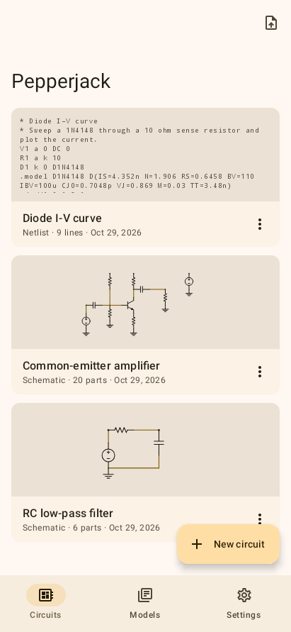
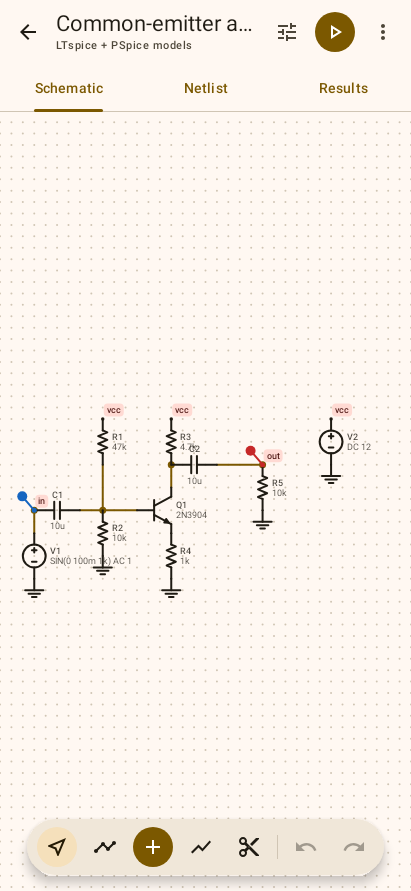
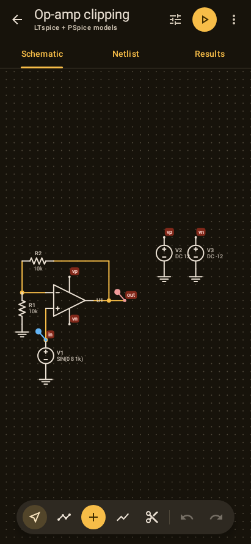
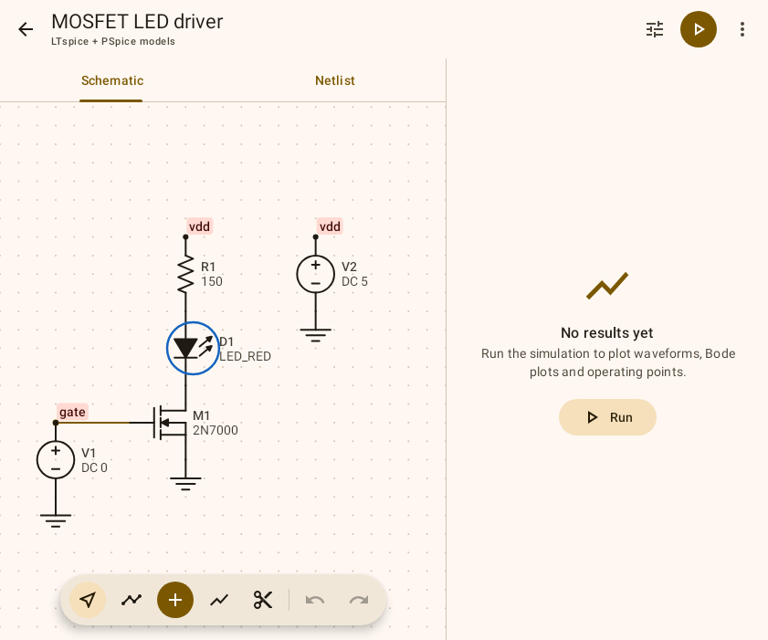
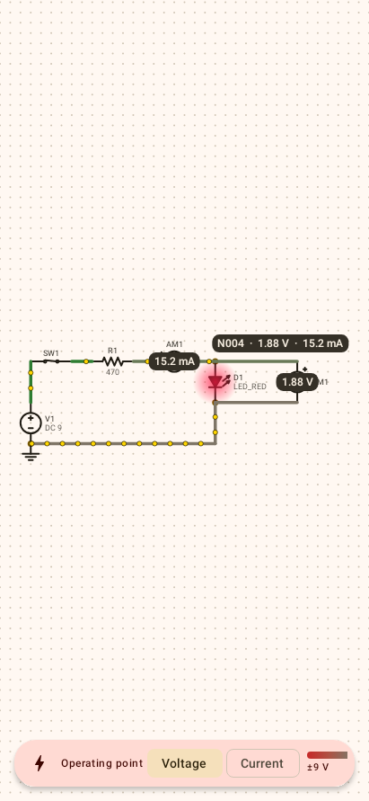
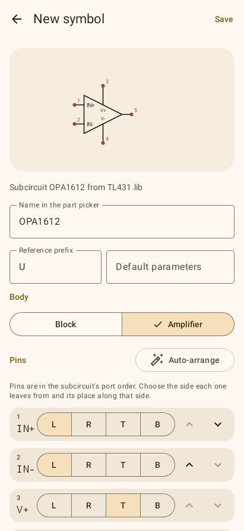
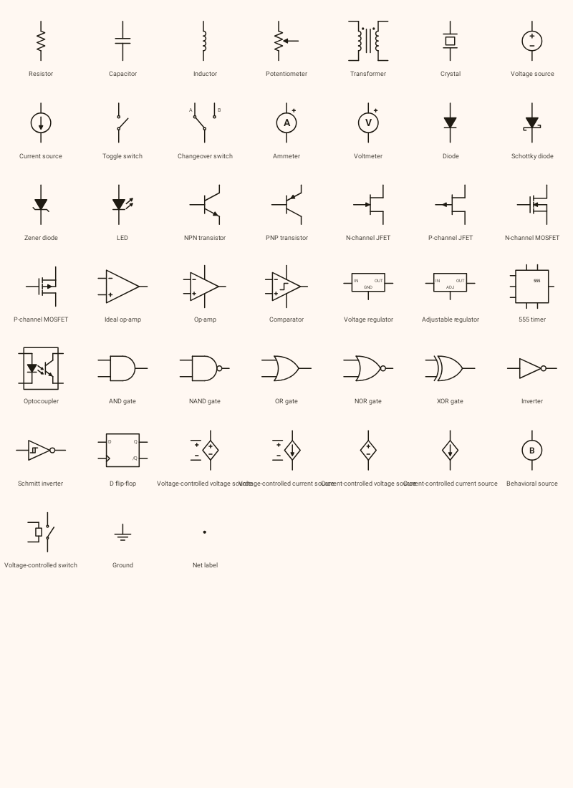

# Pepperjack

A SPICE circuit simulator for Android in the spirit of Multisim and LTspice IV.
Draw a schematic or paste a netlist, run it through a full
[ngspice](https://ngspice.sourceforge.io/) engine on the phone, and read the
waveforms, Bode plots and operating points. Built with Material 3 and designed
for foldables.

<p>
  
  
  
</p>

<p>
  
  
  
</p>

## Features

**Simulation**
- ngspice 47 runs natively on the device (arm64-v8a and x86_64), including the
  XSPICE code models that Multisim netlists rely on, KLU, CIDER and OSDI.
- Operating point, transient, AC and DC sweep from the schematic; anything
  ngspice supports from a netlist (`.noise`, `.tf`, `.four`, `.meas`, `.control`
  scripts, …).
- Simulations run in the background with progress, and can be stopped.

**SPICE dialects** — chosen app-wide in Settings or per circuit:

| Dialect | ngspice mode | Use it for |
| --- | --- | --- |
| ngspice / SPICE3 / Multisim | native | SPICE3f5, XSPICE and Multisim exports |
| LTspice | `lta` | LTspice netlists and libraries |
| PSpice / OrCAD | `psa` | Vendor PSpice models (`VALUE`, `TABLE`, `IF`) |
| LTspice + PSpice (default) | `ltpsa` | Mixed decks; the most forgiving |
| HSPICE | `hsa` | Foundry model cards |
| Berkeley SPICE3 | `s3` | Strict SPICE3 behaviour |

Pepperjack also fills two LTspice gaps that ngspice has:
- `Rser=`, `Rpar=`, `Cpar=` and `Lser=` on inductors, capacitors and voltage
  sources are rewritten into explicit parts.
- `.step` (`list`, linear, `oct`, `dec`; parameters and sources) runs one
  simulation per value and overlays the traces.

**Live simulation**
- Tap the bolt to simulate as you edit: every change re-runs ngspice.
- Wires are coloured by voltage (green positive, red negative) or by current,
  and dots flow along them at a speed set by the current. The currents come
  from measuring every pin, so they obey Kirchhoff's current law at every
  junction.
- LEDs glow with their current, and ammeters and voltmeters show their
  reading on their face. Tap a wire to read its node voltage and current.
- Interactive parts: tap a toggle or changeover switch to flip it, and drag
  the slider of a selected potentiometer.
- Transients play back in slow motion, with pause, restart and 0.1×–4× speed;
  the plots update too.

**Schematic editor**
- 45 symbols:
  - Passives: R, L, C, potentiometer, transformer, crystal.
  - Sources: voltage and current sources (DC, AC, sine, pulse, any SPICE
    source).
  - Switches and meters: toggle and changeover switches, ammeter, voltmeter.
  - Semiconductors: diode, Schottky, zener, LED, NPN, PNP, N/P JFETs, N/P
    MOSFETs.
  - ICs: ideal op-amp, op-amp, comparator, fixed and adjustable regulators,
    555 timer, optocoupler.
  - Digital logic: AND, NAND, OR, NOR, XOR, inverter, Schmitt inverter, D
    flip-flop.
  - Controlled and behavioral sources, voltage-controlled switch, ground and
    net labels.
- About 110 built-in models, each with a short datasheet summary in the model
  picker:
  - Diodes, Schottkys, zeners and LEDs.
  - 2N3904/2N2222/BC547/TIP31/2N3055-class transistors and TIP120 Darlingtons.
  - JFETs, and small-signal to power MOSFETs.
  - LM358, TL072, NE5532, OPA2134 and MCP6002 op-amps.
  - LM393/LM311 comparators.
  - 78xx/79xx, LM317/LM337 and LDO regulators.
  - NE555/TLC555, PC817/4N35, and crystals.

  Discretes use datasheet-typical parameters. ICs are behavioural
  macro-models of the datasheet headline figures: gain-bandwidth, slew rate,
  output swing, dropout, current limit and propagation delay. Every model is
  checked in ngspice on each commit.
- Drag or tap-tap wiring, rubber-band moves, rotate, mirror, duplicate,
  undo/redo, junction dots and open-pin markers.
- Probe tool: tap a wire for its voltage or a part for its current; probes take
  their trace's color, as in LTspice.
- SPICE directives on the sheet (`.param`, `.model`, `.include`, `.meas`, …) and
  the generated netlist always one tab away.

**Netlists and models**
- Syntax-highlighted netlist editor; import `.cir`, `.net`, `.sp` and LTspice
  netlist exports (View → SPICE Netlist), or open them from a file manager.
- Model library: add vendor `.lib`, `.mod`, `.sub` files, then type a model's
  name as a part's model. The file is included automatically, and the model
  picker lists the library models that fit each symbol.
- Symbol editor: make a symbol for any library subcircuit, the way LTspice
  generates block symbols. It starts from an automatic arrangement (supplies
  on top and bottom, inputs left, outputs right). You can then choose a block
  or amplifier body and move each pin to any side and position. Your symbols
  appear in the part picker.
- Export any netlist, and any plot as CSV.

**Results**
- Waveforms with pinch zoom on each axis, pan, and two cursors with Δ and 1/Δ.
- Bode plots (magnitude and phase) for AC, an operating-point table, and the
  full ngspice log.

**Material You and foldables**
- Material 3 with dynamic color on Android 12+, a warm fallback palette, light
  and dark themes, and a themed launcher icon.
- Navigation bar on phones, navigation rail on larger windows.
- Unfolded foldables and tablets show the editor and results side by side,
  split exactly at the hinge when it separates the screen. In tabletop posture
  the plots sit above the fold and the editor below it, where it is easy to
  touch. Mouse-wheel zoom works on DeX, Chromebooks and tablets with a
  trackpad.

## Install

Every push builds APKs in GitHub Actions: open the latest run under
**Actions → Android**, then download the `pepperjack-apks` artifact. Tagging a
commit `v*` publishes the release APK on the **Releases** page.

Requires Android 8.0 (API 26) or newer.

## Build it yourself

You need JDK 17 or newer, the Android SDK, and NDK r28 or newer (CI uses
29.0.14206865).

```sh
# 1. Cross-compile ngspice into app/src/main/jniLibs (a few minutes; needs cc and make)
ANDROID_NDK_HOME=$ANDROID_HOME/ndk/29.0.14206865 scripts/build-ngspice-android.sh

# 2. Build, test and install
./gradlew testDebugUnitTest assembleDebug
adb install app/build/outputs/apk/debug/app-debug.apk
```

Skipping step 1 still gives a working app; it just reports that the
simulation engine is not bundled.

`scripts/check-netlists.sh` runs exported netlists through desktop ngspice; CI
uses it to make sure every bundled example simulates:

```sh
PEPPERJACK_EXPORT_DIR=/tmp/netlists ./gradlew testDebugUnitTest --tests '*ExampleNetlistExport*'
scripts/check-netlists.sh /tmp/netlists
```

### Signed releases

Without signing secrets the release APK is signed with the debug key, so it
installs but cannot update a Play Store build. To sign with your own key, add
these repository secrets:

| Secret | Value |
| --- | --- |
| `PEPPERJACK_KEYSTORE_BASE64` | `base64 -w0 release.jks` |
| `PEPPERJACK_KEYSTORE_PASSWORD` | keystore password |
| `PEPPERJACK_KEY_ALIAS` | key alias |
| `PEPPERJACK_KEY_PASSWORD` | key password |

## How it fits together

| Path | What it does |
| --- | --- |
| `app/src/main/java/.../model` | Circuit data, part symbols and pins |
| `app/src/main/java/.../spice` | Netlister, built-in models, LTspice translation and `.step` |
| `app/src/main/java/.../sim` | ngspice engine wrapper, result types, and the live view's wire-current solver |
| `app/src/main/cpp` | JNI bridge that `dlopen`s `libngspice.so` |
| `app/src/main/java/.../ui` | Compose screens, schematic canvas, charts, adaptive layout |
| `scripts/build-ngspice-android.sh` | Cross-compiles ngspice and its code models with the NDK |

## Not supported yet

- Opening LTspice `.asc` schematics directly (export the netlist from LTspice).
- Nested `.step` sweeps (only the first `.step` is swept).
- LTspice-only devices with no ngspice equivalent, and `.wave`.
- The XSPICE `table2D`/`table3D` models (their source is GPLv2, so they are
  not bundled).

## License

Pepperjack is MIT licensed (see [LICENSE](LICENSE)).

The bundled simulator is [ngspice 47](https://sourceforge.net/projects/ngspice/files/ng-spice-rework/47/),
© the ngspice team, under the Modified BSD license, except: KLU and numparam
(LGPLv2), OSDI (MPL 2.0), and XSPICE (public domain). The exact source used is
the `ngspice-47.tar.gz` release, downloaded and verified by
`scripts/build-ngspice-android.sh`.
