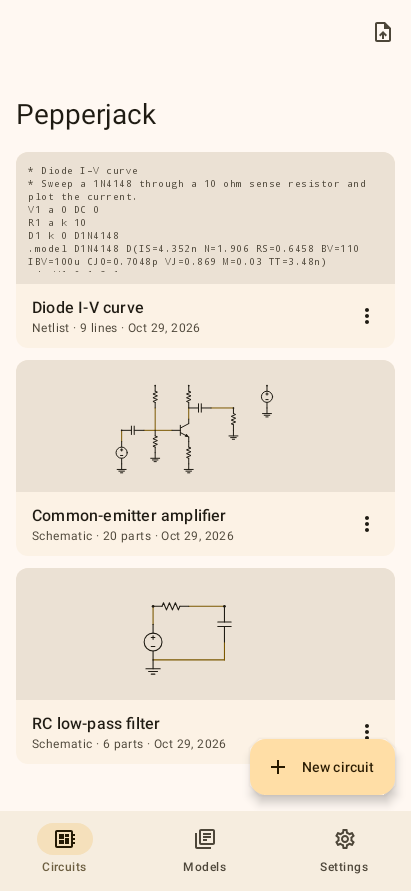
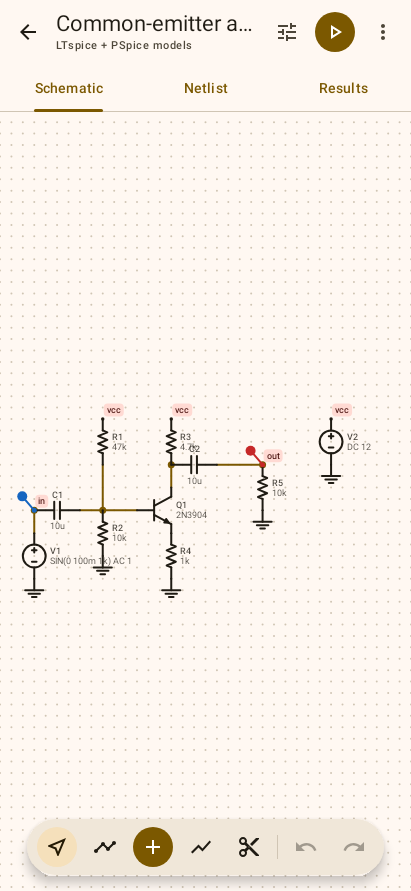
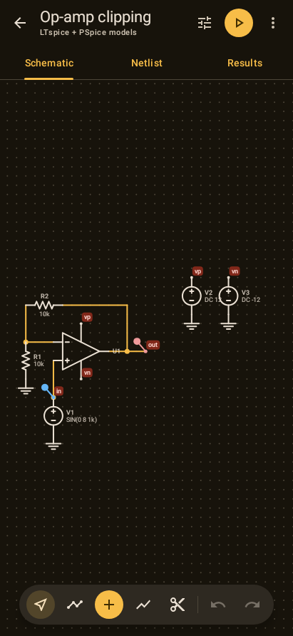
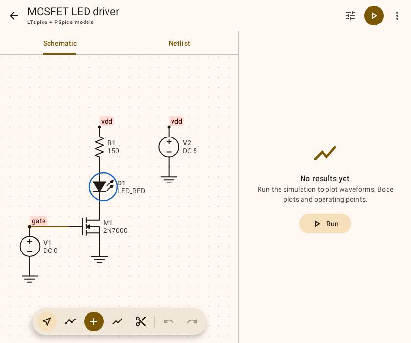
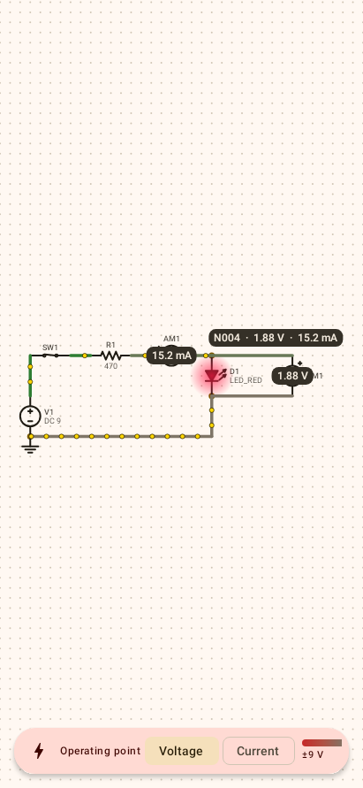
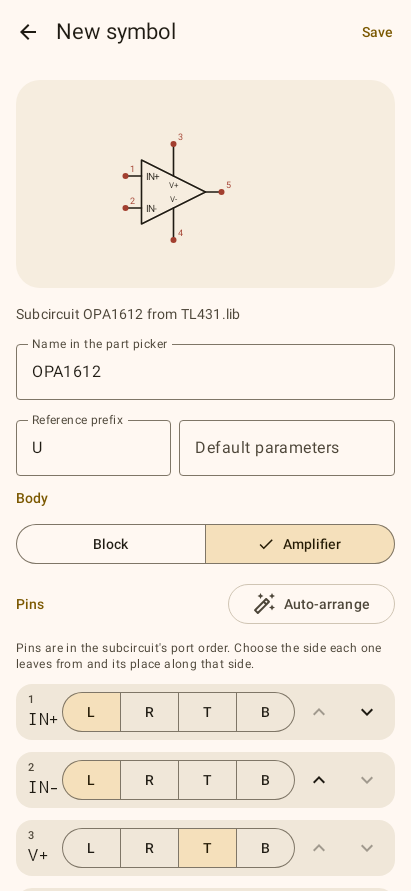
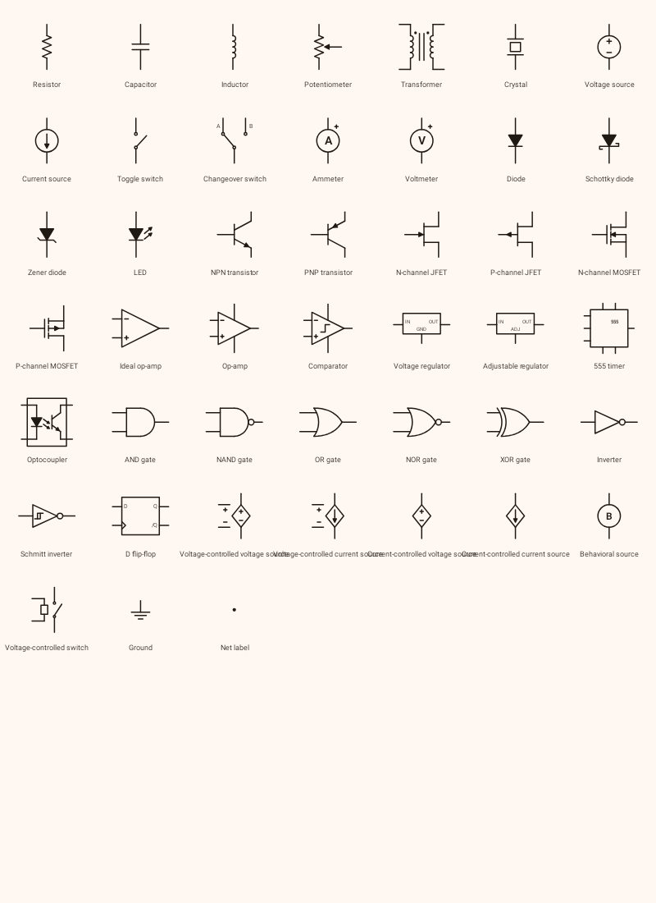

# Pepperjack

A SPICE circuit simulator for Android in the spirit of Multisim and LTspice IV.
Draw a schematic or paste a netlist, run it through a full
[ngspice](https://ngspice.sourceforge.io/) engine on the phone, and read the
waveforms, Bode plots and operating points. Built with Material 3 and designed
for foldables.

<p>
  
  
  
</p>

<p>
  
  
  
</p>

## Features

**Simulation**
- ngspice 47 runs natively on the device (arm64-v8a and x86_64), including the
  XSPICE code models that Multisim netlists rely on, KLU, CIDER and OSDI.
- Operating point, transient, AC and DC sweep from the schematic; anything
  ngspice supports from a netlist (`.noise`, `.tf`, `.four`, `.meas`, `.control`
  scripts, …).
- Simulations run in the background with progress, and can be stopped.

**SPICE dialects** — chosen app-wide in Settings or per circuit:

| Dialect | ngspice mode | Use it for |
| --- | --- | --- |
| ngspice / SPICE3 / Multisim | native | SPICE3f5, XSPICE and Multisim exports |
| LTspice | `lta` | LTspice netlists and libraries |
| PSpice / OrCAD | `psa` | Vendor PSpice models (`VALUE`, `TABLE`, `IF`) |
| LTspice + PSpice (default) | `ltpsa` | Mixed decks; the most forgiving |
| HSPICE | `hsa` | Foundry model cards |
| Berkeley SPICE3 | `s3` | Strict SPICE3 behaviour |

Pepperjack also fills two LTspice gaps that ngspice has:
- `Rser=`, `Rpar=`, `Cpar=` and `Lser=` on inductors, capacitors and voltage
  sources are rewritten into explicit parts.
- `.step` (`list`, linear, `oct`, `dec`; parameters and sources) runs one
  simulation per value and overlays the traces.

**Live simulation**
- Tap the bolt to simulate as you edit: every change re-runs ngspice.
- Wires are coloured by voltage (green positive, red negative) or by current,
  and dots flow along them at a speed set by the current. The currents come
  from measuring every pin, so they obey Kirchhoff's current law at every
  junction.
- LEDs glow with their current, and ammeters and voltmeters show their
  reading on their face. Select a meter to switch it, like a multimeter,
  between the reading now and its DC, AC (rms, DC removed), RMS or
  peak-to-peak value over the run. Tap a wire to read its node voltage and
  current.
- Interactive parts: tap a toggle or changeover switch to flip it, and drag
  the slider of a selected potentiometer.
- Controls: on a sheet with knobs or switches, the live panel opens on a
  front panel of every potentiometer and switch, with every meter's reading,
  so a big circuit can be worked without hunting for its parts. Scope is the
  other tab, and the panel and the hint above the sheet fold away for room.
- Value knobs: select a resistor, capacitor, inductor or DC source and a
  slider sweeps its value (a decade either way for R, C and L, logarithmic;
  zero to twice the level for a source). One turn is one undo step.
- Oscilloscope: every probe is a scope channel. Voltages share the left
  scale and currents the right, so channels compare directly. A transient
  sweeps across in step with the playback, with a cursor at the time being
  shown; a DC circuit rolls along over the last ten seconds, so flipping a
  switch or turning a knob shows as a step.
  - Measure: pick any of mean (DC), RMS, AC RMS, peak to peak, minimum,
    maximum, frequency and period, and the scope tabulates them for every
    channel. Mean and RMS are weighted by time, as on a bench scope.
  - Cursors: two time cursors, A and B, to drag or tap into place. The table
    shows each channel at A and at B and the difference, with Δt and 1/Δt,
    and the measurements then cover only the time between the cursors.
- Measurement probes, like Multisim's: place one on a wire (from the parts
  tray, with the probe tool, or with Plot on a tapped wire) and it shows the
  voltage there and the current along the wire, now and as peak to peak,
  RMS, DC and frequency over the run (pick which in its properties). The
  current is positive to the right or downward, as its arrow shows. Each
  probe is also a scope channel, and after a normal run its tag shows the
  voltage measurements from the results.
- Readings keep their place: numbers use fixed-width digits in fixed-width
  slots, so the controls don't shift as the playback time ticks.
- Transients play back in slow motion, with pause, restart and 0.1×–4× speed;
  the plots update too.

**Schematic editor**
- 46 symbols:
  - Passives: R, L, C, potentiometer, transformer, crystal.
  - Sources: voltage and current sources (DC, AC, sine, pulse, any SPICE
    source).
  - Switches and meters: toggle and changeover switches, ammeter, voltmeter,
    measurement probe.
  - Semiconductors: diode, Schottky, zener, LED, NPN, PNP, N/P JFETs, N/P
    MOSFETs.
  - ICs: ideal op-amp, op-amp, comparator, fixed and adjustable regulators,
    555 timer, optocoupler.
  - Digital logic: AND, NAND, OR, NOR, XOR, inverter, Schmitt inverter, D
    flip-flop.
  - Controlled and behavioral sources, voltage-controlled switch, ground and
    net labels.
- About 120 built-in models, each with a short datasheet summary in the model
  picker:
  - Diodes, Schottkys, zeners and LEDs.
  - 2N3904/2N2222/BC547/TIP31/2N3055-class transistors and TIP120 Darlingtons.
  - JFETs (including the 2N4393 chopper), and small-signal to power MOSFETs.
  - LM358, TL072, NE5532, OPA2134, MCP6002, LM301A and LM308 op-amps.
  - LM393/LM311 comparators.
  - 78xx/79xx, LM317/LM337 and LDO regulators, and the TL431 reference.
  - NE555/TLC555, PC817/4N35, and crystals.

  Discretes use datasheet-typical parameters. ICs are behavioural
  macro-models of the datasheet headline figures: gain-bandwidth, slew rate,
  output swing, dropout, current limit and propagation delay. Every model is
  checked in ngspice on each commit.
- 50 examples in ten categories, searchable, with the ones made for live mode
  marked: basics (divider, Kirchhoff, Wheatstone bridge, RC and RL steps),
  filters (RC, RLC, Sallen-Key, twin-T notch), diodes (half-wave and bridge
  rectifiers, zener regulator, clipper, clamp, doubler), transistors
  (common-emitter, emitter follower, current mirror, differential pair,
  push-pull, relay driver with flyback diode), op-amps (inverting, summing,
  integrator, instrumentation amplifier, Schmitt trigger, precision
  rectifier), oscillators (555 astable and one-shot, two-transistor astable,
  relaxation, Wien bridge), power (7805, LM317, boost converter, a triple
  bench supply), logic (half
  adder, SR latch, ripple counter), a 4–20 mA current loop, and SPICE
  netlists in each dialect.
- A triple bench supply from one 24 V input: +0–20 V and −0–20 V at 0.7 A and
  0–5 V at 1 A, each isolated by its own DC-DC module, with a knob each for
  voltage, current limit and over-voltage trip (a latching LM393 that fires a
  MOSFET crowbar). Built from TL431, LM358, LM393, TIP120 and other common
  parts; in live mode, set it from Controls: VSETn, ISETn and OVPSETn for
  each channel's volts, current limit and OVP level, and RESETn.
- The largest is channel A of a Foxboro SPEC 200 2AI-P2V RTD-to-0–10 V
  converter, laid out after the MI 2AI-185 component diagram, with a 3-wire
  Pt100 bridge, a JFET chopper amplifier and a transformer-isolated output.
  Q11 demodulates T3's 4–6 winding onto C29, as drawn, and the span divider
  (R76, R78 on the coarse-span jumper, R77, R101) feeds it back. Its clock
  and transformer are assumptions, listed in its directives. As set up it
  reads −0.002 V at 0 °C, 5.06 V at 50 °C and 9.98 V at 100 °C (R80 sets
  zero, R77 span); change `tdeg` to set the temperature.
- Parts tray: tap + for the parts, a category at a time, and drag one up out
  of the tray onto the sheet (or tap it, then tap where it goes). Search
  opens the full picker.
- Tap a part for a toolbar beside it: edit, rotate, mirror, duplicate, probe
  its current, delete.
- Select several: with the box tool, drag a box around parts and wires (or tap
  them one by one), then drag any of them to move them all, with the wires
  that join them to the rest stretching along. The bar above offers rotate,
  duplicate and delete for the whole selection.
- Tap a wire, then Plot: a probe goes on the wire and its waveform shows in
  the results (simulating first if needed), or on the scope while live.
- Drag or tap-tap wiring, rubber-band moves, undo/redo, junction dots and
  open-pin markers.
- Probe tool: tap a wire to put a measurement probe there, or a part to probe
  its current; tap a probe to remove it. Probes take their trace's color, as
  in LTspice, and can be moved and deleted like any part.
- SPICE directives on the sheet (`.param`, `.model`, `.include`, `.meas`, …) and
  the generated netlist always one tab away.

**Netlists and models**
- Syntax-highlighted netlist editor; import `.cir`, `.net`, `.sp` and LTspice
  netlist exports (View → SPICE Netlist), or open them from a file manager.
- LTspice schematics (`.asc`) open as schematics you can edit and simulate.
  The standard symbols map onto Pepperjack's, using the pin positions from
  Analog Devices' LTspice reference: R, C, L, sources, diodes, BJTs,
  MOSFETs, JFETs, controlled and behavioural sources, switches, and op-amps
  (vendor op-amps from LTspice's Opamps folder, and UniversalOpAmp, which
  runs on Pepperjack's generic op-amp). Wires, net labels, grounds and
  directives come across. Other symbols are listed in a note on the sheet.
- Model library: add vendor `.lib`, `.mod`, `.sub` files (or open them from a
  file manager), then type a model's name as a part's model. The file is
  included automatically, and the model picker lists the library models that
  fit each symbol. A library model replaces a built-in one of the same name,
  and a `.model` on the sheet replaces both. Files are tidied as they are added so ngspice can include
  them: DOS end-of-file bytes are dropped, and stray text, test circuits and
  analyses outside subcircuits become comments, so no text is lost.
- Online models: search about 66,000 manufacturer models by part number, maker
  or type, and add one with a tap. They come from the community
  [KiCad-Spice-Library](https://github.com/kicad-spice-library/KiCad-Spice-Library),
  which collects files from Texas Instruments, Analog Devices, National, Maxim
  and many other makers. The app ships only an index of names (330 kB); a file
  is downloaded from GitHub when you add it, with its maker's notice, and stays
  under its maker's terms. From a part's model picker, "Find more models
  online" lists only the models that fit that symbol. Every model was
  load-checked in ngspice when the index was built: 84% load as they are, and
  the browser marks the rest (mostly LTspice-only syntax, or references to
  models in other files).
- Symbol editor: make a symbol for any library subcircuit, the way LTspice
  generates block symbols. It starts from an automatic arrangement (supplies
  on top and bottom, inputs left, outputs right). You can then choose a block
  or amplifier body and move each pin to any side and position. Your symbols
  appear in the part picker.
- Export any netlist, and any plot as CSV.

**Results**
- Waveforms with pinch zoom on each axis, pan, and two cursors with Δ and 1/Δ.
- Measure on a transient: the same measurements as the scope (mean, RMS, AC
  RMS, peak to peak, min, max, frequency, period) for every plotted trace,
  over the run or between cursors A and B.
- Bode plots (magnitude and phase) for AC, an operating-point table, and the
  full ngspice log.

**Material You and foldables**
- Material 3 with dynamic color on Android 12+, a warm fallback palette, light
  and dark themes, and a themed launcher icon.
- Navigation bar on phones, navigation rail on larger windows.
- Unfolded foldables and tablets show the editor and results side by side,
  split exactly at the hinge when it separates the screen. In tabletop posture
  the plots sit above the fold and the editor below it, where it is easy to
  touch. Mouse-wheel zoom works on DeX, Chromebooks and tablets with a
  trackpad.

## Install

Every push builds APKs in GitHub Actions: open the latest run under
**Actions → Android**, then download the `pepperjack-apks` artifact. Tagging a
commit `v*` publishes the release APK on the **Releases** page.

Requires Android 8.0 (API 26) or newer.

## Build it yourself

You need JDK 17 or newer, the Android SDK, and NDK r28 or newer (CI uses
29.0.14206865).

```sh
# 1. Cross-compile ngspice into app/src/main/jniLibs (a few minutes; needs cc and make)
ANDROID_NDK_HOME=$ANDROID_HOME/ndk/29.0.14206865 scripts/build-ngspice-android.sh

# 2. Build, test and install
./gradlew testDebugUnitTest assembleDebug
adb install app/build/outputs/apk/debug/app-debug.apk
```

Skipping step 1 still gives a working app; it just reports that the
simulation engine is not bundled.

`scripts/check-netlists.sh` runs exported netlists through desktop ngspice; CI
uses it to make sure every bundled example simulates:

```sh
PEPPERJACK_EXPORT_DIR=/tmp/netlists ./gradlew testDebugUnitTest --tests '*ExampleNetlistExport*'
scripts/check-netlists.sh /tmp/netlists
```

### Signed releases

Without signing secrets the release APK is signed with the debug key, so it
installs but cannot update a Play Store build. To sign with your own key, add
these repository secrets:

| Secret | Value |
| --- | --- |
| `PEPPERJACK_KEYSTORE_BASE64` | `base64 -w0 release.jks` |
| `PEPPERJACK_KEYSTORE_PASSWORD` | keystore password |
| `PEPPERJACK_KEY_ALIAS` | key alias |
| `PEPPERJACK_KEY_PASSWORD` | key password |

## How it fits together

| Path | What it does |
| --- | --- |
| `app/src/main/java/.../model` | Circuit data, part symbols and pins |
| `app/src/main/java/.../spice` | Netlister, built-in models, LTspice translation and `.step` |
| `app/src/main/java/.../sim` | ngspice engine wrapper, result types, and the live view's wire-current solver |
| `app/src/main/cpp` | JNI bridge that `dlopen`s `libngspice.so` |
| `app/src/main/java/.../ui` | Compose screens, schematic canvas, charts, adaptive layout |
| `scripts/build-ngspice-android.sh` | Cross-compiles ngspice and its code models with the NDK |
| `scripts/build-model-index.py` | Rebuilds the online model index from a clone of KiCad-Spice-Library |

## Not supported yet

- LTspice symbols other than those above when opening `.asc` files: vendor ICs
  with their own pinouts and hierarchical sheets are left out and listed.
- Nested `.step` sweeps (only the first `.step` is swept).
- LTspice-only devices with no ngspice equivalent, and `.wave`.
- The XSPICE `table2D`/`table3D` models (their source is GPLv2, so they are
  not bundled).

## License

Pepperjack is MIT licensed (see [LICENSE](LICENSE)).

The online model index lists the names of the models in
[KiCad-Spice-Library](https://github.com/kicad-spice-library/KiCad-Spice-Library);
no model files are bundled. Each file is downloaded from that repository only
when you add it, and stays under its maker's terms.

The bundled simulator is [ngspice 47](https://sourceforge.net/projects/ngspice/files/ng-spice-rework/47/),
© the ngspice team, under the Modified BSD license, except: KLU and numparam
(LGPLv2), OSDI (MPL 2.0), and XSPICE (public domain). The exact source used is
the `ngspice-47.tar.gz` release, downloaded and verified by
`scripts/build-ngspice-android.sh`.
